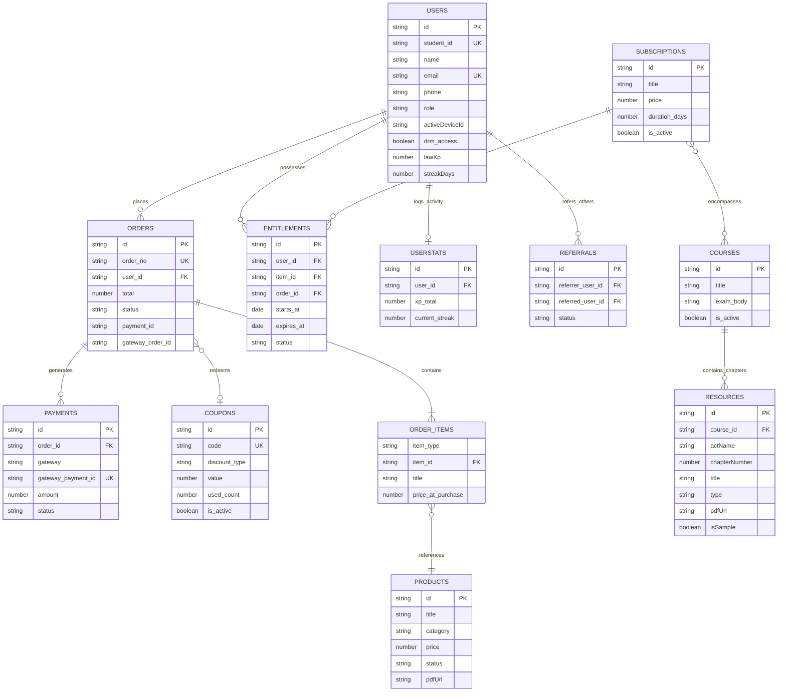
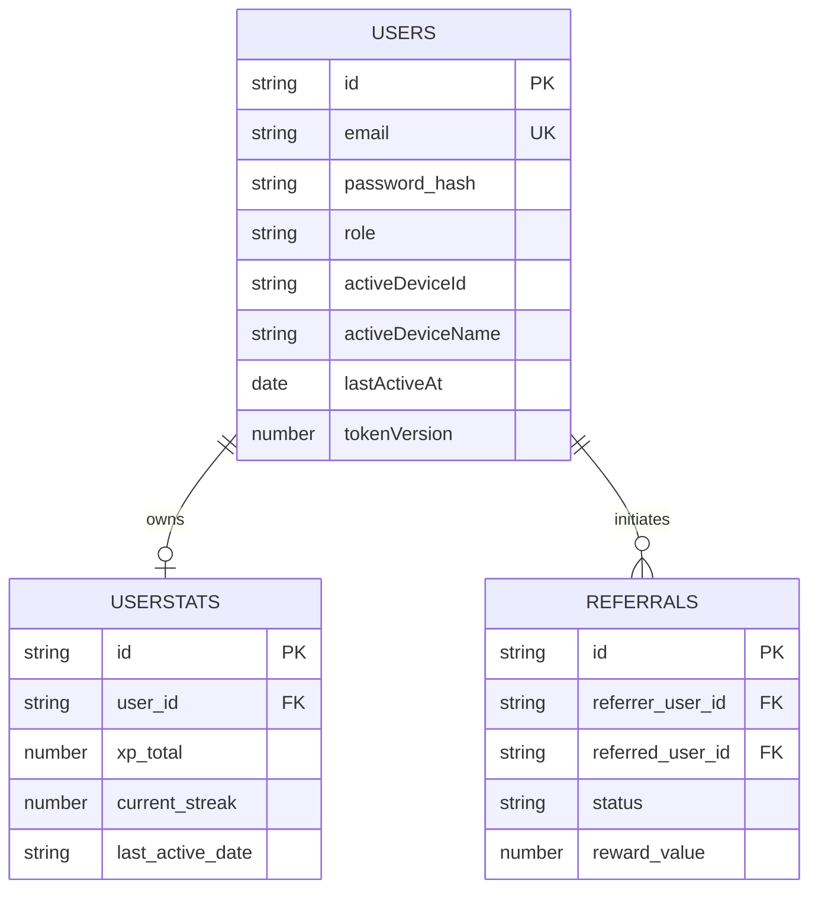
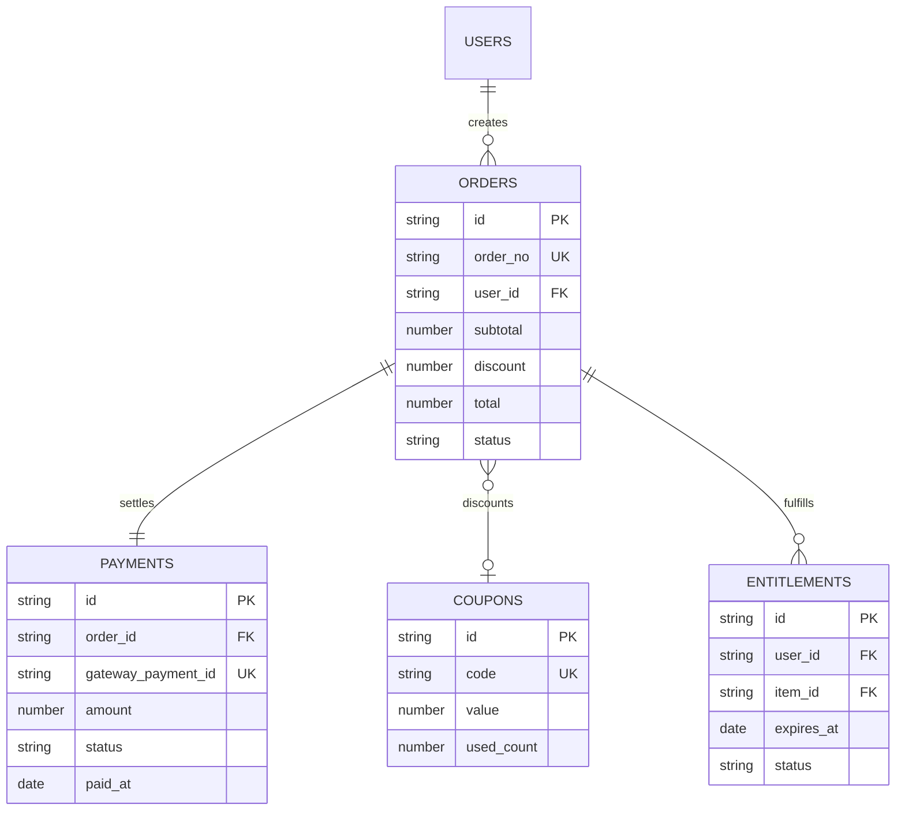
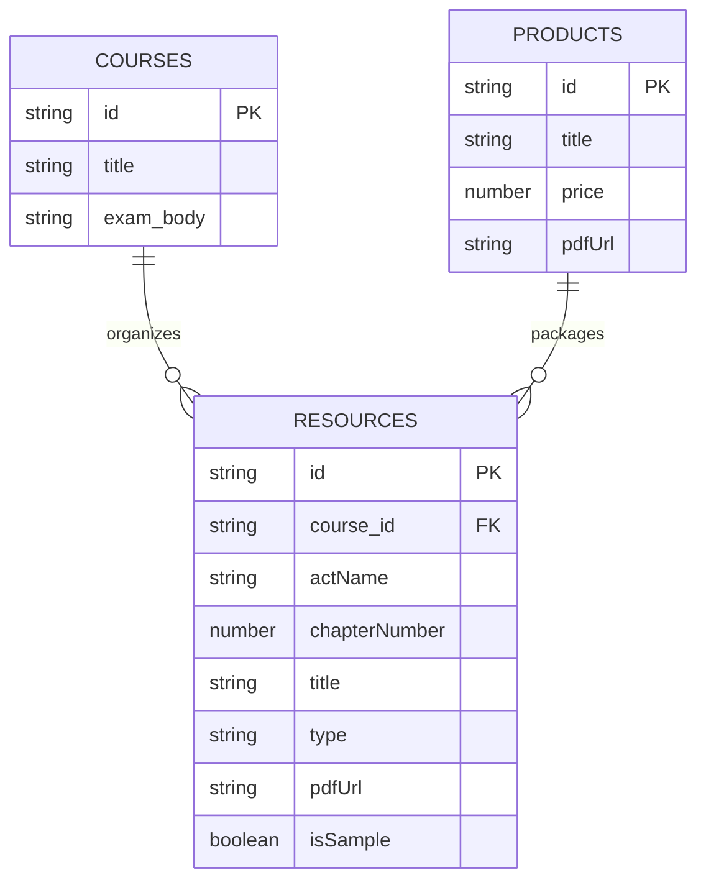
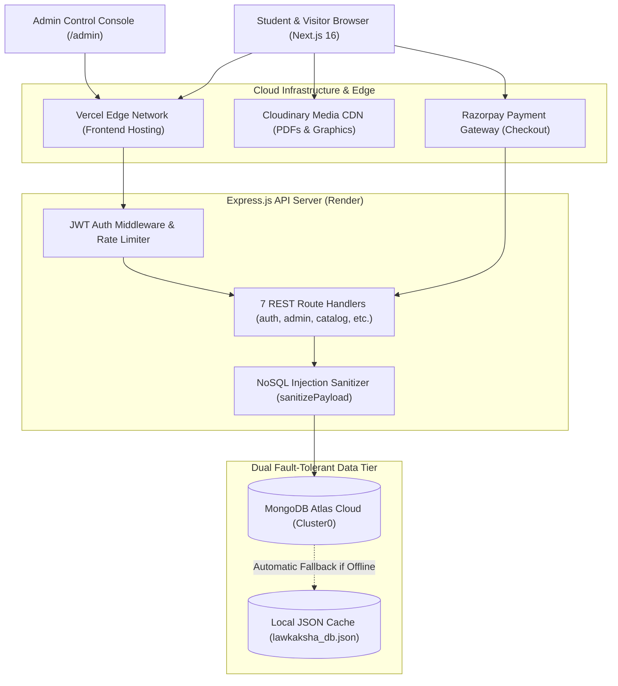
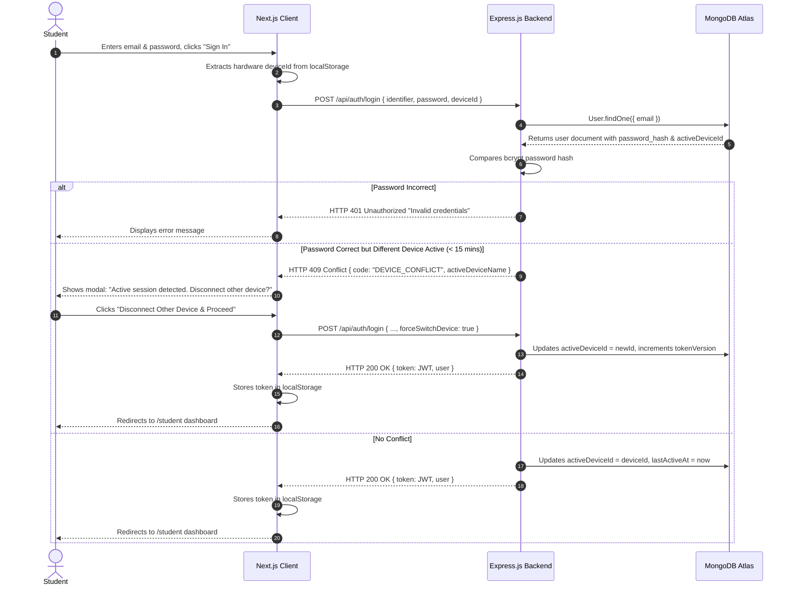
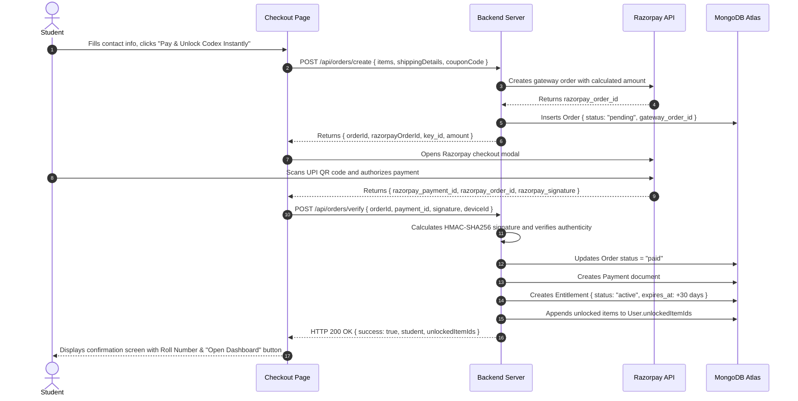

# 05. Database Architecture, Schema Specifications & Mermaid ER Diagrams

---

## 1. Database Architecture Overview

The Law Kaksha runs on a **Dual Fault-Tolerant Data Architecture**:
1. **Primary Cloud Layer:** MongoDB Atlas (Cluster0) accessed via the Mongoose ODM (`backend/src/db/mongo.js`).
2. **Local Zero-Crash Fallback:** A standalone file-backed JSON database engine (`backend/src/db/database.js`) writing to `backend/data/lawkaksha_db.json`. If MongoDB Atlas connectivity drops or IP whitelisting fails on Render, the backend continues executing read and write operations locally without throwing 500 errors to users.

---

## 2. Exhaustive Schema Specifications (All 21 Collections)

### 1. `users` Collection (`backend/src/models/User.js`)
Stores student accounts, administrator profiles, DRM permissions, and single-device hardware locks.

| Field Name | Type | Constraints / Required | Default Value | Purpose / Description |
| :--- | :--- | :--- | :--- | :--- |
| `id` | String | Required, Unique, Indexed | UUID | Primary user identifier. |
| `student_id` | String | Optional, Indexed | `""` | Official institutional roll number (e.g. `LRK-2026-004182`). |
| `name` | String | Required | — | Student's full legal name. |
| `email` | String | Required, Unique, Indexed, Trim, Lowercase | — | Primary email address for login and receipts. |
| `phone` | String | Optional, Indexed | `""` | Contact phone number for WhatsApp reminders and watermarking. |
| `password_hash` | String | Optional | — | Salted bcrypt hash (10 salt rounds). |
| `role` | String | Required, Enum | `"student"` | User access level: `"student"` or `"admin"`. |
| `target_exam` | String | Optional | `"CA Foundation Paper 2"` | Selected examination stream. |
| `is_active` | Boolean | Required | `true` | Account active status switch. |
| `drm_access` | Boolean | Required | `true` | In-web digital reader permission flag. |
| `enrolled_books` | Array[String]| Optional | `[]` | List of unlocked codex and product IDs. |
| `unlockedItemIds` | Array[String]| Optional | `[]` | Exact IDs of study resources accessible to student. |
| `streakDays` | Number | Optional | `1` | Consecutive days with active study sessions. |
| `lawXp` | Number | Optional | `120` | Cumulative gamified experience points. |
| `completedUnits` | Array[String]| Optional | `[]` | Chapter units marked as completed. |
| `bookmarks` | Array[String]| Optional | `[]` | Saved notes and flowchart IDs. |
| `lastRead` | Object | Optional | `{ progress: 45 }` | Title, URL, date, and scroll percentage of last accessed note. |
| `todayMinutes` | Number | Optional | `0` | Reading minutes recorded today. |
| `todayGoalMinutes`| Number | Optional | `45` | Daily study time target. |
| `joined_date` | String | Optional | `"Today"` | Date student account was created. |
| `activeDeviceId` | String | Optional | `""` | Browser fingerprint / Hardware ID of active device. |
| `activeDeviceName`| String | Optional | `""` | Friendly name (e.g. "Windows Chrome", "Mac Safari"). |
| `activeSessionToken`| String | Optional | `""` | JWT token bound to current device. |
| `lastActiveAt` | Date | Optional | `Date.now` | Timestamp of latest heartbeat ping or API call. |
| `boundGmail` | String | Optional | `""` | Linked Google account email. |
| `googleId` | String | Optional | `""` | Google OAuth subject identifier. |
| `avatar_url` | String | Optional | `""` | Profile picture URL from Google or Cloudinary. |
| `referral_code` | String | Optional, Indexed | `""` | Student's unique invite code (e.g. `REF-PARAKH-2026`). |
| `referred_by_user_id`| String | Optional | `null` | User ID of the student who referred this user. |
| `city` / `state` | String | Optional | `""` | Geographic location details. |
| `resetPasswordToken`| String | Optional | `""` | Cryptographic token for password reset. |
| `resetPasswordExpires`| Date | Optional | `null` | Expiration timestamp of reset token. |

---

### 2. `products` Collection (`backend/src/models/Product.js`)
Core curriculum codices and complete study packages sold via the catalog.

| Field Name | Type | Constraints | Default Value | Purpose |
| :--- | :--- | :--- | :--- | :--- |
| `id` | String | Required, Unique, Indexed | UUID | Primary product identifier (e.g. `prod-vol1`). |
| `title` | String | Required | — | Product display title. |
| `subtitle` | String | Optional | `""` | Marketing subtitle. |
| `category` | String | Enum: `["CA Foundation", "CSEET", "Both"]` | `"CA Foundation"` | Curriculum classification. |
| `format` | String | Optional | `"Digital Codex (In-Web DRM)"` | Delivery format. |
| `price` | Number | Required | — | Actual selling price in INR (e.g. `99`). |
| `originalPrice` | Number | Optional | `499` | Strikethrough maximum retail price (MRP). |
| `pages` | String | Optional | `"150+ Pages"` | Approximate length of notes. |
| `status` | String | Enum: `["Active", "Draft"]` | `"Active"` | Public visibility toggle. |
| `pdfUrl` | String | Optional | — | Cloudinary CDN link to source PDF. |
| `units` | Array[String]| Optional | `[]` | Chapter/unit syllabus outline. |
| `cover_image` | String | Optional | `"/assets/ca-cs-hero-books-v2.png"` | Product graphic URL. |
| `previewPagesLimit`| Number | Optional | `5` | Maximum pages readable by non-paying users. |

---

### 3. `resources` Collection (`backend/src/models/Resource.js`)
Granular chapter notes, revision flowcharts, infographics, and practice question PDFs.

| Field Name | Type | Constraints | Default Value | Purpose |
| :--- | :--- | :--- | :--- | :--- |
| `id` | String | Required, Unique, Indexed | UUID | Primary resource identifier (e.g. `res-ca-soga-1`). |
| `course` / `course_id`| String | Indexed | `"ca-foundation"` | Target course code. |
| `actName` | String | Optional | `"Contract Act"` | Statutory Act (e.g. *The Sale of Goods Act, 1930*). |
| `chapterNumber` | Number | Optional | `1` | Numerical chapter sequence. |
| `title` | String | Required | — | Resource title. |
| `type` | String | Enum: `["video", "pdf", "notes", "link", "flowchart", "practice", "pyq", "case_study", "ldr", "infographic"]` | `"pdf"` | Content type categorization. |
| `pdfUrl` | String | Optional | `""` | Cloudinary or local path to note PDF. |
| `isSample` | Boolean | Optional | `false` | True if available to public non-paying users. |
| `status` | String | Enum: `["Published", "Draft", "Coming Soon"]` | `"Published"` | Publication state. |
| `order` / `display_order`| Number | Optional | `0` | Sorting sequence inside curriculum tab. |
| `is_active` | Boolean | Indexed | `true` | Active switch. |
| `cloudinaryPublicId` | String | Optional | `""` | Cloudinary media management identifier. |

---

### 4. `orders` Collection (`backend/src/models/Order.js`)
Transactional record of student purchases, subtotal calculations, and applied coupon discounts.

| Field Name | Type | Constraints | Default Value | Purpose |
| :--- | :--- | :--- | :--- | :--- |
| `id` | String | Required, Unique, Indexed | UUID | Internal system order ID. |
| `order_no` | String | Required, Unique, Indexed | — | Human-friendly invoice number (e.g. `ORD-2026-9812`). |
| `user_id` | String | Required, Indexed | — | Foreign key pointing to `User.id`. |
| `personal_details` | Object | Required | `{ name, email, phone }` | Customer contact snapshot at time of checkout. |
| `items` | Array[Object]| Required | `[]` | Purchased items array: `{ item_type, item_id, title, price_at_purchase }`. |
| `subtotal` | Number | Required | — | Base amount before discounts. |
| `discount` | Number | Optional | `0` | Total discount subtracted by coupon. |
| `coupon_code` | String | Optional | `""` | Code used (e.g. `LAUNCH99`). |
| `total` | Number | Required | — | Final payable amount in INR. |
| `status` | String | Enum: `["pending", "paid", "failed", "refunded"]` | `"pending"` | Payment fulfillment state. |
| `payment_id` | String | Optional | `""` | Razorpay payment ID (`pay_xxx`). |
| `gateway_order_id`| String | Optional | `""` | Razorpay order ID (`order_xxx`). |

---

### 5. `payments` Collection (`backend/src/models/Payment.js`)
Cryptographically verified payment gateway receipts.

| Field Name | Type | Constraints | Default Value | Purpose |
| :--- | :--- | :--- | :--- | :--- |
| `id` | String | Required, Unique, Indexed | UUID | System payment identifier. |
| `order_id` | String | Required, Indexed | — | Foreign key pointing to `Order.id`. |
| `gateway` | String | Optional | `"razorpay"` | Payment gateway provider. |
| `gateway_order_id`| String | Indexed | `""` | Razorpay Order ID. |
| `gateway_payment_id`| String| Indexed | `""` | Razorpay Payment ID. |
| `amount` | Number | Required | — | Net amount charged in INR. |
| `currency` | String | Optional | `"INR"` | Currency denomination. |
| `status` | String | Enum: `["pending", "success", "failed", "refunded"]` | `"pending"` | Verification outcome. |
| `method` | String | Optional | `"UPI"` | Instrument used (UPI, Card, NetBanking). |
| `paid_at` | Date | Optional | — | Exact gateway transaction timestamp. |
| `raw_payload` | Mixed | Optional | `null` | Raw webhook response stored for audit trails. |

---

### 6. `entitlements` Collection (`backend/src/models/Entitlement.js`)
Access permissions granting a student rights to read specific codices or notes for a defined time window.

| Field Name | Type | Constraints | Default Value | Purpose |
| :--- | :--- | :--- | :--- | :--- |
| `id` | String | Required, Unique, Indexed | UUID | Primary entitlement ID. |
| `user_id` | String | Required, Indexed | — | Foreign key pointing to `User.id`. |
| `user_email` | String | Indexed | — | Student email index. |
| `item_type` | String | Enum: `["subscription", "extra_course", "course", "product"]` | `"subscription"` | Categorization of unlocked content. |
| `item_id` | String | Required, Indexed | — | Foreign key pointing to `Product.id` or `Subscription.id`. |
| `order_id` | String | Required | — | Foreign key pointing to `Order.id`. |
| `starts_at` | Date | Optional | `Date.now` | Pass start timestamp. |
| `expires_at` | Date | Required, Indexed | — | Pass expiration timestamp (e.g. +30 Days). |
| `status` | String | Enum: `["active", "expired", "revoked"]` | `"active"` | Active permission gate. |

---

### 7. `subscriptions` Collection (`backend/src/models/Subscription.js`)
30-Day study pass plan configurations (and backwards-compatible enrollment records).

| Field Name | Type | Constraints | Default Value | Purpose |
| :--- | :--- | :--- | :--- | :--- |
| `id` | String | Required, Unique, Indexed | UUID | Subscription plan ID. |
| `title` | String | Required | — | Display title (e.g. *"30-Day CA Foundation Study Pass"*). |
| `slug` | String | Indexed | `""` | URL-friendly slug. |
| `price` | Number | Optional | `99` | Monthly price in INR. |
| `mrp` | Number | Optional | `299` | Maximum retail price. |
| `duration_days` | Number | Optional | `30` | Access validity duration in days. |
| `features` | Array[String]| Optional | `[]` | Bullet point feature inclusions. |
| `is_active` | Boolean | Indexed | `true` | Active switch for public purchase. |
| `studentName` | String | Optional | `""` | Legacy student enrollment record support. |
| `email` | String | Optional, Indexed | `""` | Legacy student email index. |
| `accessStatus` | String | Enum: `["Active", "Pending", "Revoked"]` | `"Active"` | Legacy subscription access status. |

---

### 8. `coupons` Collection (`backend/src/models/Coupon.js`)
Discount codes validated during cart review and checkout.

| Field Name | Type | Constraints | Default Value | Purpose |
| :--- | :--- | :--- | :--- | :--- |
| `id` | String | Required, Unique, Indexed | UUID | Primary coupon ID. |
| `code` | String | Required, Unique, Uppercase, Trim, Indexed | — | Promo code string (e.g. `LAUNCH99`). |
| `discount_type`| String | Enum: `["percent", "flat"]` | `"percent"` | Percentage vs fixed rupee deduction. |
| `value` | Number | Required | — | Discount value (e.g. `20` for 20% or `50` for ₹50). |
| `min_order` | Number | Optional | `0` | Minimum order subtotal required to apply. |
| `valid_to` | Date | Optional | — | Calendar expiration date. |
| `usage_limit` | Number | Optional | `500` | Maximum lifetime redemptions allowed. |
| `used_count` | Number | Optional | `0` | Number of times redeemed so far. |
| `is_active` | Boolean | Indexed | `true` | Admin toggle switch. |

---

### 9. `expenses` Collection (`backend/src/models/Expense.js`)
Operating expenses logged by the administrator for P&L tracking.

| Field Name | Type | Constraints | Default Value | Purpose |
| :--- | :--- | :--- | :--- | :--- |
| `id` | String | Required, Unique, Indexed | UUID | Expense record ID. |
| `category` | String | Required, Indexed | — | Category (*Hosting, Cloudinary, Marketing, Content*). |
| `title` | String | Required | — | Expenditure description. |
| `amount` | Number | Required | — | Expense cost in INR. |
| `expense_date` | Date | Optional, Indexed | `Date.now` | Date expense was incurred. |
| `receipt_url` | String | Optional | `""` | Vendor invoice link. |
| `created_by` | String | Optional | `"admin"` | Administrator username. |

---

### 10. `casestudies` Collection (`backend/src/models/CaseStudy.js`)
Curated landmark legal precedents and model answers.

| Field Name | Type | Constraints | Default Value | Purpose |
| :--- | :--- | :--- | :--- | :--- |
| `id` | String | Required, Unique, Indexed | UUID | Case study ID. |
| `title` | String | Required | — | Case study title. |
| `slug` | String | Required, Unique, Indexed | — | URL slug. |
| `act_name` | String | Optional | `"Contract Act"` | Statutory Act classification. |
| `summary` | String | Optional | `""` | Brief facts synopsis. |
| `content` | String | Optional | `""` | Full 4-part legal breakdown. |
| `marks_weight` | Number | Optional | `6` | ICAI examination marks allocation. |
| `show_on_website`| Boolean | Indexed | `true` | Public marketing visibility. |
| `show_on_dashboard`| Boolean | Indexed | `true` | Student dashboard visibility. |
| `is_published` | Boolean | Indexed | `true` | Publication switch. |

---

### 11. `weeklycases` Collection (`backend/src/models/WeeklyCase.js`)
Weekly case scenarios featured on the public homepage.

| Field Name | Type | Constraints | Default Value | Purpose |
| :--- | :--- | :--- | :--- | :--- |
| `id` | String | Required, Unique, Indexed | UUID | Weekly case ID. |
| `day` | String | Optional | `"Monday"` | Day of week banner. |
| `badge` | String | Optional | `"Contract Act 1872"` | Category badge. |
| `title` | String | Required | — | Case title. |
| `scenario` | String | Optional | `""` | Factual scenario question. |
| `modelAnswer` | String | Optional | `""` | Model solution. |
| `marks` | String | Optional | `"6 Marks"` | Marks weightage. |

---

### 12. `mcqtests` Collection (`backend/src/models/McqTest.js`)
Google Forms-based timed mock examinations.

| Field Name | Type | Constraints | Default Value | Purpose |
| :--- | :--- | :--- | :--- | :--- |
| `id` | String | Required, Unique, Indexed | UUID | Test drill ID. |
| `title` | String | Required | — | Test title. |
| `course` | String | Enum: `["ca", "cs", "both"]` | `"ca"` | Stream filter. |
| `subject` | String | Optional | — | Subject title. |
| `formUrl` | String | Required | — | Embedded or external Google Forms URL. |
| `duration` | Number | Optional | `30` | Allotted exam duration in minutes. |
| `totalMarks` | Number | Optional | `30` | Total test marks. |
| `status` | String | Enum: `["Active", "Draft"]` | `"Active"` | Student access switch. |

---

### 13. `mcqquestions` Collection (`backend/src/models/McqQuestion.js`)
Individual multiple-choice questions used for practice quizzes and QOTD.

| Field Name | Type | Constraints | Default Value | Purpose |
| :--- | :--- | :--- | :--- | :--- |
| `id` | String | Required, Unique, Indexed | UUID | Question ID. |
| `subject` | String | Optional | `"Indian Contract Act"` | Subject name. |
| `section` | String | Optional | `"Section 10"` | Statutory section reference. |
| `question` | String | Required | — | Question text. |
| `options` | Array[String]| Optional | `[]` | 4 multiple choice options. |
| `correctOption`| Number | Optional | `0` | Zero-based index of correct option. |
| `explanation` | String | Optional | `""` | Detailed legal reasoning. |

---

### 14. `livesessions` Collection (`backend/src/models/LiveSession.js`)
Live doubt sessions schedule and meeting links.

| Field Name | Type | Constraints | Default Value | Purpose |
| :--- | :--- | :--- | :--- | :--- |
| `id` | String | Required, Unique, Indexed | UUID | Live session ID. |
| `title` | String | Required | — | Session agenda title. |
| `starts_at` | Date | Required, Indexed | — | Scheduled start time. |
| `ends_at` | Date | Required | — | Scheduled end time. |
| `meet_link` | String | Required | — | Video conference URL (Google Meet / Zoom). |
| `is_active` | Boolean | Indexed | `true` | Active switch. |

---

### 15. `carouselslides` Collection (`backend/src/models/CarouselSlide.js`)
Homepage visual hero cards.

| Field Name | Type | Constraints | Default Value | Purpose |
| :--- | :--- | :--- | :--- | :--- |
| `id` | String | Required, Unique, Indexed | UUID | Slide ID. |
| `title` | String | Required | — | Main heading. |
| `subtitle` | String | Optional | `""` | Subtitle. |
| `image` | String | Optional | `""` | Background or hero image URL. |
| `cta_label` | String | Optional | `"Explore Plan"` | Button text. |
| `cta_link` | String | Optional | `"/courses"` | Button target route. |
| `display_order`| Number | Optional | `0` | Numerical sequence. |
| `is_active` | Boolean | Indexed | `true` | Visibility toggle. |

---

### 16. `offers` Collection (`backend/src/models/Offer.js`)
Promotional discount banners on `/offers`.

| Field Name | Type | Constraints | Default Value | Purpose |
| :--- | :--- | :--- | :--- | :--- |
| `id` | String | Required, Unique, Indexed | UUID | Offer ID. |
| `title` | String | Required | — | Offer headline. |
| `description` | String | Optional | `""` | Promotional details. |
| `coupon_code` | String | Optional | `""` | Linked coupon code. |
| `valid_to` | Date | Optional | — | Flash sale end timestamp. |
| `is_active` | Boolean | Indexed | `true` | Visibility toggle. |

---

### 17. `referrals` Collection (`backend/src/models/Referral.js`)
Student affiliate referral records.

| Field Name | Type | Constraints | Default Value | Purpose |
| :--- | :--- | :--- | :--- | :--- |
| `id` | String | Required, Unique, Indexed | UUID | Referral ID. |
| `referrer_user_id`| String | Required, Indexed | — | Foreign key pointing to `User.id` (inviter). |
| `referred_user_id`| String | Required, Indexed | — | Foreign key pointing to `User.id` (invited student). |
| `status` | String | Enum: `["pending", "qualified", "rewarded"]` | `"pending"` | Referral reward progress. |
| `reward_type` | String | Enum: `["xp_bonus", "coupon", "feature_unlock"]` | `"xp_bonus"` | Reward category. |
| `reward_value` | Mixed | Optional | `50` | Reward quantity (e.g. 50 XP). |
| `reward_claimed`| Boolean | Optional | `false` | True if claimed by inviter. |

---

### 18. `userstats` Collection (`backend/src/models/UserStats.js`)
Gamified learning activity log tracking LawXP awards and daily streaks.

| Field Name | Type | Constraints | Default Value | Purpose |
| :--- | :--- | :--- | :--- | :--- |
| `id` | String | Required, Unique, Indexed | UUID | Stats record ID. |
| `user_id` | String | Required, Unique, Indexed | — | Foreign key pointing to `User.id`. |
| `xp_total` | Number | Optional | `0` | Cumulative LawXP points. |
| `current_streak`| Number | Optional | `0` | Active streak in consecutive days. |
| `longest_streak`| Number | Optional | `0` | All-time longest streak achieved. |
| `events` | Array[Object]| Optional | `[]` | Sub-schema: `{ type, points, ref_type, ref_id, created_at }`. |

---

### 19. `courses` Collection (`backend/src/models/Course.js`)
High-level educational programs (CA Foundation vs CSEET).

| Field Name | Type | Constraints | Default Value | Purpose |
| :--- | :--- | :--- | :--- | :--- |
| `id` | String | Required, Unique, Indexed | UUID | Course code (e.g. `course-ca-foundation`). |
| `title` | String | Required | — | Program title. |
| `exam_body` | String | Optional | `"ICAI"` | Examination authority (ICAI / ICSI). |
| `units_count` | Number | Optional | `0` | Total syllabus chapters/units. |
| `is_active` | Boolean | Indexed | `true` | Visibility toggle. |

---

### 20. `sitesettings` Collection (`backend/src/models/SiteSetting.js`)
Dynamic platform-wide configuration stored as key-value pairs.

| Field Name | Type | Constraints | Default Value | Purpose |
| :--- | :--- | :--- | :--- | :--- |
| `key` | String | Required, Unique, Indexed | — | Unique configuration key (e.g. `"announcement"`). |
| `value` | Mixed | Required | — | JSON object payload. |

---

### 21. `subscriptionplans` (Alias)
Exports `Subscription` model directly (`backend/src/models/SubscriptionPlan.js`).

---

## 3. Master Database Entity-Relationship (ER) Diagram

---

## 4. Modular ER Diagrams by Business Domain

### A. Authentication, Identity & Hardware Locks

### B. E-Commerce, Razorpay Payments & Entitlements

### C. Courseware, Resources & DRM Assets

---

## 5. Architectural Flow & Sequence Diagrams

### Overall System Architecture

### Authentication & Single-Device Gate Sequence Flow

### Complete Razorpay Payment & Access Unlock Flow

---

## 6. Schema Health: Unused Fields, Redundancies & Missing Indexes

### A. Deprecated & Redundant Schema Fields
1. **`User.tempPassword` (`backend/src/models/User.js:35`):** Unused leftover from manual account creation scripts; should be removed to prevent storing plaintext remnants.
2. **`Order` Duplicate Fields (`backend/src/models/Order.js:37–41`):** Redundant dual declarations (`orderId` vs `id`, `userEmail` vs `personal_details.email`, `amount` vs `total`).
3. **`Subscription` Dual Personality (`backend/src/models/Subscription.js:21–32`):** Contains plan catalog definitions (`title`, `price`, `duration_days`) mingled with student subscription instances (`studentName`, `studentRoll`, `email`, `phone`). This causes architectural confusion between *what plans exist* vs *who has purchased a plan*.

### B. Missing Index Recommendations
1. `Resource.js`: Lacks a compound index on `{ course: 1, chapterNumber: 1, status: 1 }`, resulting in full collection scans when students fetch chapter notes.
2. `Order.js`: Lacks a compound index on `{ user_id: 1, createdAt: -1 }`, which will cause slow sorting when rendering student order histories at scale.
3. `UserStats.js`: `events.created_at` lacks an index, slowing down 30-day streak calculation queries.
