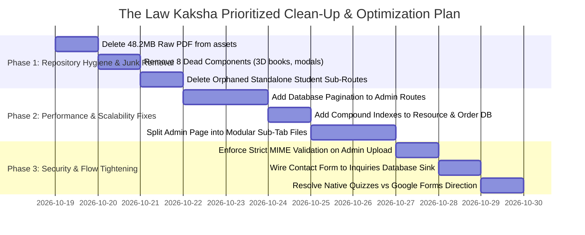

# 09. Master Feature Matrix, Platform Metrics & Action Roadmap

---

## 1. Platform-Wide Metrics & Aggregate Counts

| Metric Category | Count Verified in Codebase | Verification Source |
| :--- | :---: | :--- |
| **Total Next.js App Router Page Directories** | **31 Pages** | `frontend/src/app/` directory tree. |
| **Active Public Website Routes** | **19 Routes** | Marketing, legal, catalog, cart, and checkout pages. |
| **Admin Console Navigation Hubs & Tabs** | **5 Hubs / 16 Tabs** | `frontend/src/app/admin/page.tsx` (`SHORTLISTED_NAV`). |
| **Student Dashboard Navigation Tabs** | **8 Tabs** | `frontend/src/app/student/page.tsx` (`NAV_ITEMS`). |
| **Total Discrete Functional Features** | **68 Features** | Verified across all portals. |
| **Total Tracked Interactive Triggers** | **84 Triggers** | Button clicks, form submits, and modal gates. |
| **Total REST API Endpoints** | **68 Endpoints** | 7 backend route modules + health probes. |
| **Total Database Collections / Tables** | **21 Collections** | `backend/src/models/` + `lawkaksha_db.json`. |
| **Total Reusable React Components** | **56 Components**| `frontend/src/components/` directory. |
| **Dead / Unreferenced Components Identified** | **8 Components**| 140+ KB dead code slated for deletion. |
| **Orphaned Standalone Student Sub-Routes** | **8 Routes** | Subfolders inside `frontend/src/app/student/`. |

---

## 2. Master Feature Matrix

| Feature Description | Portal Location | Implementation Status | Primary Code Files | Technical Notes |
| :--- | :--- | :---: | :--- | :--- |
| **Hero Course Showcase** | Public Website | **Complete** | `HeroSection.tsx`, `page.tsx` | Interactive cover cards, quick sample modal trigger. |
| **Top Announcement Bar** | Public & Student | **Complete** | `AnnouncementBar.tsx`, `AdminBroadcastTab.tsx` | Admin controlled live via `POST /api/admin/announcement`. |
| **Curriculum Outline & Previews**| Public Website | **Complete** | `courses/page.tsx`, `catalogRoutes.js` | 7 CA chapters & 8 CSEET units with free sample preview. |
| **Shopping Cart Drawer** | Public Website | **Complete** | `CartDrawer.tsx`, `CartContext.tsx` | Slide-out drawer, coupon discount input, subtotal math. |
| **Razorpay Checkout Gateway** | Public Website | **Complete** | `checkout/page.tsx`, `orderRoutes.js` | HMAC-SHA256 verified payments, UPI QR & Card support. |
| **Single-Device Hardware Lock** | Student Portal | **Complete** | `authRoutes.js`, `deviceHelper.ts` | Prevents credential sharing via `409 DEVICE_CONFLICT`. |
| **Token Version Revocation** | Backend Auth | **Complete** | `authMiddleware.js`, `User.js` | Immediate session invalidation upon password reset. |
| **In-Web Canvas DRM Reader** | Student Dashboard | **Complete** | `SecurePdfReader.tsx`, `student/page.tsx`| HTML5 canvas rendering, dynamic watermark, print-blocked. |
| **Daily Streak & LawXP System** | Student Dashboard | **Complete** | `studentRoutes.js`, `UserStats.js` | Gamified study streak counter and experience points. |
| **Daily Question of the Day** | Public & Student | **Complete** | `ExamCountdownsAndQOTD.tsx`, `adminRoutes.js`| Daily statutory problem granting +15 LawXP on completion. |
| **Exam Countdown Timers** | Public & Student | **Complete** | `ExamCountdownsAndQOTD.tsx`, `AdminExam...Tab.tsx`| Dynamic countdown to official ICAI & ICSI exam dates. |
| **Section 16 Comparator** | Public Website | **Complete** | `Section16ComparisonBlock.tsx` | Bare Act statutory text vs Visual Model Framework. |
| **Student Directory & DRM Toggle**| Admin Console | **Complete** | `admin/page.tsx`, `adminRoutes.js` | 1-Click DRM permission kill switch and device reset. |
| **Study Materials CRUD** | Admin Console | **Complete** | `admin/page.tsx`, `Product.js`, `Resource.js`| Add, edit, delete books, chapter notes, and sample limits. |
| **Cloudinary Direct File Upload**| Admin Console | **Complete** | `adminRoutes.js`, `cloudinary.js` | Streams uploaded PDFs to Cloudinary CDN via memory buffer.|
| **Discount Coupon Engine** | Admin & Checkout | **Complete** | `Coupon.js`, `CartContext.tsx` | Percentage & flat discounts with usage tracking limits. |
| **P&L Financial Ledger** | Admin Console | **Complete** | `AdminExpensesTab.tsx`, `Expense.js` | Gross revenue minus operating costs = Net profit margin. |
| **1-Click WhatsApp Reminders** | Admin Console | **Complete** | `admin/page.tsx` | Deep links with pre-filled renewal and receipt messages. |
| **Google Meet Live Classes** | Admin & Student | **Deprecated** | `AdminLiveSessionsTab.tsx`, `LiveSession.js`| Module removed from UI per owner instruction. |
| **3D Three.js Book Viewer** | Reader / Books | **Deprecated** | `Book3DViewer.tsx`, `Interactive3DBooks.tsx`| Disabled to optimize low-end mobile devices and battery. |
| **Standalone Student Sub-Pages**| Student Portal | **Unused / Orphaned**| `student/calendar/`, `student/profile/`, etc.| Disconnected standalone routes; main app is an all-in-one SPA. |
| **Native Interactive Quiz Engine**| Backend Only | **Partial / Unused** | `quizRoutes.js`, `QuizTakingModal.tsx` | Backend supports native quizzes, but admin uses Google Forms. |
| **Contact Inquiry Database Sink**| Contact Page | **Missing** | `contact/page.tsx` | Form displays alert but does not persist inquiry to database.|

---

## 3. Top 10 Architectural Strengths

1. **Dual-Tier Fault-Tolerant Database Engine:** The transparent fallback to `backend/data/lawkaksha_db.json` prevents database disconnection crashes during Render server cold boots or MongoDB Atlas maintenance.
2. **Robust Single-Device Hardware Lock:** Hardware fingerprinting and `409 DEVICE_CONFLICT` challenge protect intellectual property and subscription revenue against commercial credential sharing.
3. **Proprietary DRM In-Web Canvas Reader:** Rendering PDFs directly onto HTML5 canvases eliminates raw file URLs, blocks right-clicking/copying, and renders dynamic student watermarks across every page.
4. **Instant Token Version Invalidation:** Incorporating `tokenVersion` into JWT sessions guarantees that password changes or administrative access bans take effect across all devices within seconds.
5. **NoSQL Injection & Prototype Pollution Sanitizer:** Recursive payload sanitization in `server.js` strips malicious MongoDB operators and prototype injection keys at the network perimeter.
6. **Unified Centralized Checkout:** Seamless Razorpay integration with cryptographic HMAC-SHA256 server-side signature verification ensures zero fraudulent access grants.
7. **Production Configuration Guardrails:** Server immediately halts if `JWT_SECRET` is missing in production, preventing vulnerable default key deployments.
8. **Automated WhatsApp Business Automation:** Pre-formatted deep links for instant receipts and 5-day expiration notices streamline student support and renewal conversions.
9. **Curated CA Foundation & CSEET Pedagogy:** The courseware directly addresses ICAI Paper 2 requirements (e.g. Section 16 implied conditions, *Priest v. Last*, *Cox v. Hickman*).
10. **Rich Aesthetic Design Language:** Curated warm paper (`#F7F7F5`) and deep navy palette (`#221D1D`, `#005A9C`) creates an authoritative, distraction-free educational reading environment.

---

## 4. Top 10 Weaknesses & Architectural Risks

1. **Unpaginated Admin Database Queries (High Risk):** `User.find()` and `Order.find()` return unbounded arrays. At scale, this will exhaust Render's 512MB RAM and crash the backend.
2. **Repository Asset Bloat (High Risk):** A **48.2 MB raw textbook PDF** is committed in `frontend/public/assets/`, consuming deployment bandwidth and risking public unauthorized downloading.
3. **Monolithic 4,800-Line Admin Component (Medium Risk):** Housing 16 workspaces in `frontend/src/app/admin/page.tsx` causes heavy virtual DOM re-renders and code maintainability friction.
4. **Orphaned Standalone Student Sub-Routes (Low Risk / Tech Debt):** 8 disconnected page files in `frontend/src/app/student/` create confusion for developers maintaining navigation.
5. **Dead / Unused UI Components (Low Risk / Tech Debt):** Over 140 KB of dead code (e.g., deprecated 3D book viewer, unmounted evaluation desks) remains in `frontend/src/components/`.
6. **In-Memory Rate Limiting (Medium Risk):** Sliding-window rate limiters reset on server restart; multi-instance horizontal scaling requires distributed Redis storage.
7. **Admin File Upload Lacks Strict MIME Checking (Medium Risk):** `multer` does not validate file magic bytes, allowing non-PDF uploads if an admin account is compromised.
8. **Contact Form Has No Backend Sink (Medium Risk):** User inquiries submitted on `/contact` are not saved to any database collection.
9. **Compound Query Indexes Missing (Medium Risk):** `Resource` and `Order` collections lack compound indexes, causing unindexed collection scans as note libraries grow.
10. **Dual Quiz Engine Inconsistency (Low Risk / Tech Debt):** Admin portal configures Google Form URLs, while backend maintains a separate native quiz engine with no UI.

---

## 5. Prioritized Fix & Remediation Roadmap

### Immediate Action Checklist:
- [ ] **Step 1: Delete Bloated Assets:** Delete `frontend/public/assets/CSEET BUSINESS MANAGEMENT FINAL PRINT COPY.pdf` and duplicate cover images.
- [ ] **Step 2: Remove Dead Components:** Delete `Book3DViewer.tsx`, `Interactive3DBooks.tsx`, `DigitalBookshelf.tsx`, `SecurePdfReaderModal.tsx`, `EducatorLectures.tsx`, `ReviewerFeatures.tsx`, `BareActDecoderTool.tsx`, `MainsEvaluationDeskModal.tsx`, and `AdminLiveSessionsTab.tsx`.
- [ ] **Step 3: Remove Orphaned Routes:** Remove disconnected sub-routes in `frontend/src/app/student/` (calendar, case-studies, courses, explore, login, profile, refer, resources, checkout).
- [ ] **Step 4: Implement Pagination:** Add `page` and `limit` to `GET /api/admin/students` and `GET /api/admin/orders`.
- [ ] **Step 5: Add Database Indexes:** Add `{ course: 1, chapterNumber: 1, status: 1 }` to `Resource.js`.

---

## 6. Questions for the Project Owner's Clarification

1. **MCQ Examination Format Strategy:**  
   *Current state:* The admin console creates test links pointing to external **Google Forms** (`formUrl`), but the backend route `quizRoutes.js` contains a complete **native interactive quiz engine** with automated scoring and LawXP calculation.  
   *Question:* Do you prefer continuing to use Google Forms, or would you like to build an admin UI to manage native quizzes directly inside the platform?

2. **Contact Inquiries Destination:**  
   *Current state:* The `/contact` form currently displays a thank-you alert without saving to a database.  
   *Question:* Should inquiries be saved to a new `Inquiries` collection in MongoDB for admin viewing, or should the form submit directly to your WhatsApp Business number?

3. **Standalone Sub-Routes vs. Single Page App:**  
   *Current state:* The student portal currently functions as an all-in-one SPA at `/student`. The individual pages (`/student/courses`, `/student/calendar`, `/student/profile`) are unused leftovers.  
   *Question:* May we permanently delete these 8 leftover sub-route folders to keep the codebase clean?
